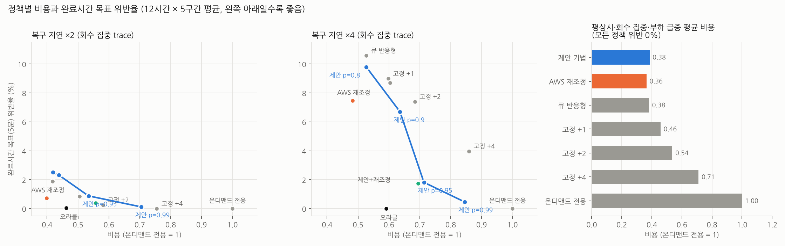

# spot-swallow

제비처럼 사라졌다가 다시 돌아오는 스팟 워커. 하지만 메시지는 절대 삼키지 않습니다. (*Never swallows a message.*)

**정합성이 깨지면 안 되는 비동기 작업 처리 시스템**을 언제 꺼질지 모르는 스팟 인스턴스 위에서 돌립니다.
워커가 아무 때나 죽어도 작업 유실·중복은 0건이어야 하고, 털린 워커가 결과를 바꿀 수도 없어야 합니다.
그 위에서, 복구 시간과 동시 회수를 고려해 여유 워커 수를 정하는 **적응형 여유 용량 제어**를 연구했습니다.
예시 작업은 가맹점 정산(거래 → 수수료 → 정산금)이지만, 구조는 작업 종류와 무관합니다.

> 경희대학교 컴퓨터공학과 2026 졸업프로젝트
> "가변적 복구 시간과 동시 회수를 고려한 스팟 인스턴스 기반 비동기 작업 처리 시스템의 적응형 여유 용량 제어"

**1분 시연**: [docs/demo/demo.mp4](docs/demo/demo.mp4). 스팟 3대를 경고 없이 동시에 죽여도 대사는 정상이고,
누가 DB 에서 결과를 1원 바꾸면 대사·알림이 잡고 감사 체인에 누가 바꿨는지 남는 장면입니다 (`scripts/demo.py`).

## 결론: 서버 복구 시간으로 고른다

회수가 몰리는 기록으로 복구 시간(새 서버가 일할 수 있게 되기까지)을 바꿔 가며 돌렸다 (시뮬레이션, 각 칸 `위반율 · 비용(온디맨드만 = 1)`).

| 복구 시간 | AWS 재조정 (기본) | 고정 여유 2대 (기존 논문식) | 제안 기법 | 고를 것 |
|---|---|---|---|---|
| 1~2.5분 | 0% · 0.35 | 0% · 0.56 | 0% · 0.35 | 같음, AWS 기본으로 충분 |
| 3.75분 | 0% · 0.37 | 0% · 0.56 | 0% · 0.48 | **AWS 기본** (제안은 비용만 더) |
| 5분 | 0.72% · 0.40 | 0.25% · 0.58 | 0.40% · 0.56 | 경계 |
| 7.5분 | 3.52% · 0.43 | 3.79% · 0.62 | **1.70%** · 0.61 | **제안** |
| 10분 | 7.46% · 0.48 | 7.39% · 0.68 | **1.75%** · 0.69 | **제안** |
| 15분 | 14.91% · 0.61 | 13.07% · 0.77 | **3.05%** · 0.73 | **제안** |

- **복구 4분 이하면 AWS 기본 기능으로 충분하다.** 서울 c6i.large 실측 복구는 약 15초로 이 영역이다.
- **7.5분 이상이면 제안 기법**: AWS 기본보다 위반율 2~5배 낮고(비용 20~44% 더), 기존 고정 여유와 비슷한 비용에 위반율 2~4배 낮다. 평균 회수율 기반(Snape식)은 10분에서 8.69% vs 1.75%.
- **실제 시스템(부팅 10분, 회수가 몰린 구간, 정책당 1회)**: 마감 초과 AWS 기본 48.8% · 고정 +2 40.3% · 제안 0%, 비용도 제안이 가장 낮았다($0.347 vs $0.382, $0.357).
- 복구가 길어지는 경우: 용량이 부족한 GPU, 큰 모델·이미지 적재, 무거운 준비 절차. 적용 예시는 GPU 배치 추론.
- 한계: 환경을 미리 알고 그 환경 하나에 맞춰 온디맨드 대수를 고정하는 AWS 혼합 설정은 제안 기법과 같거나 낫다 ([week4-hardening](docs/week4-hardening.md) 3절).

## 핵심 결과

| 질문 | 결과 | 근거 |
|---|---|---|
| 워커가 아무 때나 죽어도 돈이 맞나 | 경고 없는 강제 종료 1,449회 + 커밋 직후 자체 종료 148회, 작업 7,000건 유실·중복·금액 불일치 0 | [week3-kill-1000](docs/week3-kill-1000.md) |
| 어디서 죽어도 맞나 | 장애 지점 8종(발행기, 워커 계산 중·커밋 후, 브로커·DB 재시작, 독성 메시지, 동시 대량 회수) × 3회, 작업 9,600건 PASS | [week3-fault-matrix](docs/week3-fault-matrix.md) |
| 복구가 느릴 때 여유 용량 제어가 필요한가 | 위 결론. 근거 | [week2-simulation](docs/week2-simulation.md) 결과 3-1, [week4-hardening](docs/week4-hardening.md) 2절 |
| AWS 기본·기존 논문보다 나은가 | 설정 하나로 8개 환경(평상시~복구 15분)을 돌렸을 때, AWS 재조정 대비 평상시 비용은 같고(0.37) 최악 위반율은 14.91% → 3.05% (p=0.95, 대신 평균 비용 +21%). 기존 논문식 고정 여유(AWS 재조정 + 스팟 여유 3대) 대비 비슷한 비용(0.66 vs 0.65)에 최악 위반율 10.61% → 0.67% (p=0.99). 평균 회수율 기반(Snape식)은 복구 지연 ×4 에서 8.69% vs 1.75% (시뮬레이션) | [week4-hardening](docs/week4-hardening.md) 3절, [week2-simulation](docs/week2-simulation.md) |
| 한계: 가장 강한 기준선 | 환경을 미리 알고 그 환경 하나에 맞춘 AWS 혼합 설정(온디맨드 k대 고정)은 제안 기법과 같거나 낫다 | [week4-hardening](docs/week4-hardening.md) 3절 |
| 한 달에 얼마인가 | 하루 15만 건 규모, 공개 가격: 온디맨드만 월 $289, AWS 재조정 $109, 스팟 여유 3대 $170, 제안 p=0.95 $136 · p=0.99 $181 (시뮬레이션) | [cost-report](docs/cost-report.md) |
| 복구 몇 분을 처리 순서로 메울 수 있나 | 급한 작업 우선순위 큐: 워커 3/4 회수 중 급한 작업 마감 초과 68.5% → 0% | [week4-hardening](docs/week4-hardening.md) 4절 |
| 긴 작업이 죽으면 처음부터 다시 하나 | 중간 저장: 계산 240초 절약, 전체 처리 시간 −16% | [week4-hardening](docs/week4-hardening.md) 5절 |
| 털린 워커가 결과를 바꿀 수 있나 | 워커 계정은 추가만. 관리자 변경·트리거 우회·감사 기록 변조·체인 재계산까지 모두 드러남, 보안 시험 23/23 | [threat-model](docs/threat-model.md), [week4-hardening](docs/week4-hardening.md) 6절 |
| 보안이 복구를 늦추나 | Vault 동적 시크릿 부트스트랩 92ms, 복구 시간의 약 1% (EC2 20회) | [tready-ec2](docs/tready-ec2.md) |
| 사람이 모르는 장애를 잡을 수 있나 | GameDay 1회차(원장 변조): 감지 10초, 복구 22초 | [gameday](docs/gameday/report-1.md) |

이론(시뮬레이터)과 실제가 달랐던 점과 다음 설계에서 고려할 점은 [week4-hardening](docs/week4-hardening.md) 7절에 모았습니다.

## 구조

```
 [안정 영역: 온디맨드]                                        [스팟 영역]
  클라이언트 ─POST─▶ settlement-api ──(1 트랜잭션)──▶ PostgreSQL
                        │  settlement_jobs + outbox      ▲   ▲
                        │                                │   │ 짧은 트랜잭션으로 결과 확정
                   Outbox 발행기 ──Publisher Confirm──▶ RabbitMQ ──수동 Ack──▶ settlement-worker × N
                                                                     (prefetch=1)
  Python 제어기 ──워커 수 결정·교체──▶ (스팟 / 온디맨드 워커)
  Prometheus / Grafana ◀── 지표 (작업 나이, 큐, 워커 수, 대사 불일치, DLQ)   대사 ── 결과 감사 해시 체인 + DB 밖 앵커
```

| 장애 상황 | 일어나는 일 | 막는 장치 |
| --- | --- | --- |
| 작업 저장 직후, 큐 발행 전에 API 가 죽음 | 아웃박스에 남아 있어 재시작 후 발행 | Transactional Outbox |
| 브로커 수신 후, 발행 완료 표시 전에 죽음 | 같은 메시지가 한 번 더 발행됨 | 워커 멱등성 |
| 워커가 계산 중 회수됨 | Ack 가 없으므로 다른 워커에게 재전달 | 수동 Ack |
| 워커가 커밋 후, Ack 전 회수됨 | 재전달되지만 PK 충돌로 결과는 한 번만 확정 | `settlement_results.job_id` PK |
| 다시 해도 실패하는 메시지 | DLQ 로 격리, 큐 전체가 막히지 않음 | Dead Letter Queue |
| DB 일시 장애 | 커밋 전이므로 큐로 되돌려 재시도 | 커밋 후 Ack 순서 |
| 털린 워커가 결과를 바꾸려 함 | 권한 거부 (결과·이력은 추가만) | 워커 전용 최소 권한 DB 계정 |
| 관리자가 결과를 몰래 바꿈 | 감사 체인·DB 밖 앵커와 달라 대사가 잡음 | 결과 감사 해시 체인 |

전달은 최소 한 번(at-least-once), 반영은 정확히 한 번(effectively-once)입니다.

## 실행

필요: JDK 21, Maven, Docker

```bash
mvn -q package -DskipTests
docker compose up -d --build --scale settlement-worker=3

python3 scripts/e2e.py --resubmit        # 작업 100건 처리 후 대사 결과 확인
```

| 주소 | 용도 |
| --- | --- |
| http://localhost:8080/reconciliation | 대사 결과 (유실·중복·금액 불일치) |
| http://localhost:15672 | RabbitMQ 관리 화면 (swallow / swallow) |
| http://localhost:9090 | Prometheus |
| http://localhost:3000 | Grafana |

### 장애 주입

```bash
# 워커가 "커밋 후, Ack 전" 에 30% 확률로 즉시 종료 (kill -9 와 같은 효과)
CHAOS_CRASH_POINT=AFTER_COMMIT_BEFORE_ACK CHAOS_CRASH_PROBABILITY=0.3 scripts/reset.sh 3
python3 scripts/e2e.py

# 계산 중 종료
CHAOS_CRASH_POINT=BEFORE_COMMIT CHAOS_CRASH_PROBABILITY=0.3 scripts/reset.sh 3

# 발행기가 브로커 수신 후, 발행 완료 표시 전에 종료
CHAOS_PUBLISHER_CRASH_PROBABILITY=0.2 scripts/reset.sh 3

# 실행 중인 워커를 4초마다 하나씩 docker kill (스팟 회수 흉내)
scripts/reset.sh 3 && python3 scripts/e2e.py --kill-every 4
```

워커는 스스로 재시작하지 않습니다(`restart: "no"`). `e2e.py` 가 Auto Scaling 그룹 역할을 맡아,
종료된 워커를 `--recovery` 초(기본 3초) 뒤에 다시 띄웁니다. 3주차에는 Python 제어기가 이 역할을 맡고,
EC2 에서 측정한 복구 시간 분포를 주입합니다.

### 1주차 검증 결과 (작업 100건, 워커 3대)

| 시나리오 | 강제 종료 | 흡수한 중복 전달 | 유실 | 중복 확정 | 금액 불일치 |
| --- | --- | --- | --- | --- | --- |
| 장애 없음 (+ 같은 요청 100건 재전송) | 0 | 0 | 0 | 0 | 0 |
| 커밋 후 Ack 전 30% 종료 | 약 50회 | 51 | 0 | 0 | 0 |
| 4초마다 회수 + 커밋 후 Ack 전 20% 종료 | 27회 회수, 48회 교체 | 24 | 0 | 0 | 0 |
| 4초마다 회수 + 발행기 2% 종료 | 회수 다수, 발행기 1회 | 4 | 0 | 0 | 0 |

### 2주차 결과 요약

복구가 오래 걸리고 회수가 몰리는 상황(복구 지연 ×4)에서 제안 기법은 고정 여유 4대보다 싸면서(온디맨드 대비 0.71 vs 0.86)
완료시간 목표 위반율이 절반 이하입니다(1.8% vs 4.0%). AWS Capacity Rebalancing 은 이 상황에서 위반율 7.5%,
복구가 빠른 상황에서는 AWS 쪽이 더 낫습니다. 평상시에는 고정 여유 2대보다 30% 쌉니다.



```bash
pip install matplotlib pytest
python3 -m pytest -q tests            # 제어 알고리즘 단위 테스트 (중간보고서 예시 재현 포함)
python3 -m sim.run_experiments        # 정책 비교 795회 (4코어 약 5분)
python3 -m sim.plots
```

## API

| 메서드 | 경로 | 설명 |
| --- | --- | --- |
| POST | `/settlement-jobs` | `{"merchantId":"M0001","settlementDate":"2026-11-01"}` 접수. 새로 접수되면 202, 이미 있으면 200 (멱등) |
| GET | `/settlement-jobs/{jobId}` | 작업 상태와 정산 결과 |
| GET | `/reconciliation` | 대사: 입력 거래로 다시 계산한 금액과 확정 결과 비교 |
| POST | `/admin/seed` | 실험용 합성 거래 적재 |
| GET, POST | `/admin/dlq`, `/admin/dlq/replay` | DLQ 조회, 재처리 |
| POST | `/admin/audit-anchor` | 감사 체인 끝 해시를 지금 DB 밖에 남김 (평소에는 1분마다) |

## 데이터 모델

- `transactions`: 정산 입력 거래 (불변)
- `settlement_jobs`: 가맹점 × 정산일 = 작업 1건. `job_id` 가 요청에서 결정되어 같은 요청은 두 번 접수되지 않음
- `outbox`: 작업과 같은 트랜잭션으로 기록되는 발행 대기 메시지
- `settlement_results`: 확정 결과. `job_id` PK 가 멱등성의 핵심
- `job_events`: 처리 이력 (접수, 확정, 중복 흡수, DLQ 격리)
- `job_checkpoints`: 긴 작업의 중간 저장 (속도용, 정합성과 무관)
- `result_audit`: 결과 추가·변경·삭제마다 DB 트리거가 남기는 SHA-256 해시 체인 (추가만 가능)

## 시연

```bash
mvn -q package -DskipTests
docker compose up -d --build postgres rabbitmq settlement-api prometheus grafana
node scripts/record_demo.js &   # (선택) 녹화. 끝나면 docs/demo/demo.mp4
python3 scripts/demo.py          # 약 5분: 제어기 기동 → 부하 → 스팟 3대 회수 → 교체 → 대사 → 1원 변조 탐지 → 복구
# 브라우저: http://localhost:3000/d/spot-swallow?refresh=5s&from=now-5m&to=now
```

## 문서

| 문서 | 내용 |
|---|---|
| [measurements](docs/measurements.md), [tready-ec2](docs/tready-ec2.md) | 처리 시간, EC2 복구 시간·보안 부트스트랩 실측 |
| [week2-simulation](docs/week2-simulation.md) | 시뮬레이터, 정책 비교, 복구 시간 경계선 |
| [week3-fault-matrix](docs/week3-fault-matrix.md), [week3-kill-1000](docs/week3-kill-1000.md) | 장애 주입 매트릭스, 강제 종료 1,000회 이상 |
| [week4-spot-notice](docs/week4-spot-notice.md), [week4-live-long-boot](docs/week4-live-long-boot.md) | 회수 경고 처리, 부팅 10분 실제 시스템 비교 |
| [week4-hardening](docs/week4-hardening.md) | 교체 순서 수정, 가장 강한 기준선, 마감 등급, 중간 저장, 최소 권한·감사 체인, 이론과 실제의 차이 |
| [threat-model](docs/threat-model.md) | 위협 모델과 신뢰 경계 |
| [cost-report](docs/cost-report.md) | 월 비용 금액표 |
| [runbook](docs/runbook.md), [gameday](docs/gameday/README.md) | 알림별 대응 절차, GameDay |
| [decisions](docs/decisions.md), [failure-log](docs/failure-log.md) | 설계 결정, 실패와 수정 기록 |

## 진행 상황

- [x] 1주차: 백엔드 뼈대 (Outbox, 수동 Ack, 멱등성, 대사, 장애 주입 훅), 처리 시간 측정, 공개 회수 기록 변환
- [x] 1주차: EC2 Spot 복구 시간 측정, 보안 부트스트랩 비용 측정
- [x] 2주차: 제어기와 시뮬레이터, 정책 비교, 복구 시간 경계선
- [x] 3주차: Python 제어기 연동, 회수 주입기, Grafana 대시보드·알림, DLQ 재처리, 장애 주입 매트릭스, 강제 종료 1,000회 이상
- [x] 4주차: 회수 경고 처리, 실제 시스템 정책 비교, 가장 강한 기준선, 마감 등급, 중간 저장, 최소 권한·감사 체인, 위협 모델, 비용표, 시연
- [ ] GameDay 2·3회차 (사람이 대응), 최종 보고서, 발표자료
