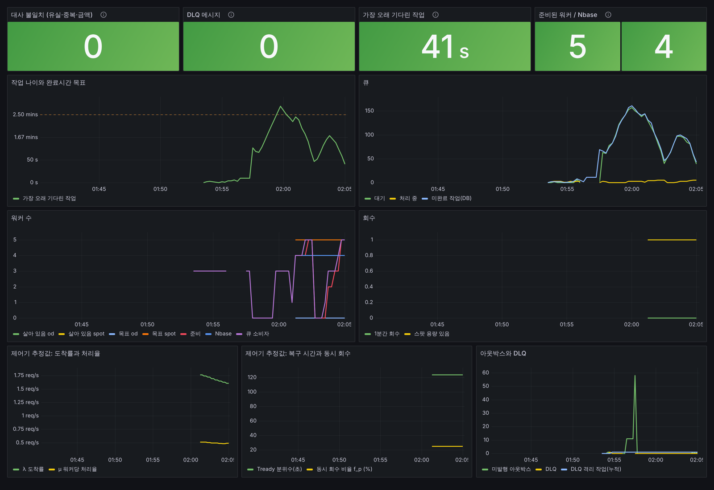

# 런북: 알림별 대응 절차

GameDay 와 실제 운영에서 알림이 울렸을 때 이 순서대로 본다. 대시보드: Grafana `spot-swallow 정산 운영`
(http://localhost:3000/d/spot-swallow). 알림 규칙: `infra/grafana/provisioning/alerting/rules.yml`.



공통 원칙

1. **돈이 틀렸는지 먼저 본다.** 대시보드 왼쪽 위 "대사 불일치"가 0 이면 지연 문제이고, 0 이 아니면 정합성 사고다.
2. 복구 후에는 반드시 `curl localhost:8080/reconciliation` 으로 `consistent: true` 를 확인하고 나서 종료를 선언한다.
3. 감지·복구 시각을 장애 보고서 템플릿(플랜 문서)에 적는다. Grafana 알림 상태 기록(Alerting → 규칙 → State history)에 시각이 남는다.

## 알림이 실제로 울리는지 점검

`scripts/alert_drill.py` 가 장애를 하나씩 만들고 감지·해제까지 걸린 시간을 잰다 (2026-11-24, 로컬 docker, 부하 초당 1건).

| 장애 | 알림 | 감지(초) | 복구 후 해제(초) |
| --- | --- | --- | --- |
| 독성 메시지 1건 | DLQ에 메시지가 있음 | 6 | 10 |
| 정산 결과 1건 금액 변조 | 대사 불일치 발생 | 21 | 30 |
| RabbitMQ 일시 정지 | 미발행 아웃박스가 1분 넘게 쌓임 | 78 | 20 |
| 워커 전부 정지 (제어기 없음) | 작업이 완료시간 목표의 절반을 넘게 기다림 | 96 | 50 |
| 워커 전부 강제 종료 (제어기 있음, 부팅 60초) | 준비된 워커가 Nbase보다 적음 | 50 | 90 |

감지 시간 = 지표 수집(5초) + 규칙 평가(10초) + 규칙 자체의 대기 조건(아웃박스 1분, 워커 부족 30초, 작업 나이는 150초까지 쌓이는 시간).

<a id="recon"></a>
## 대사 불일치 발생

뜻: 입력 거래로 다시 계산한 정산과 확정 결과가 다르다. 유실(`statusResultMismatch`), 금액 불일치(`amountMismatch`),
이중 확정(`doubleCompleted`), 감사 체인 이상(`auditChain`) 중 하나다. **가장 심각한 알림이다.**

1. `curl -s localhost:8080/reconciliation` 으로 어느 항목인지 본다.
2. 금액 불일치: 해당 작업을 찾는다.
   ```sql
   SELECT r.job_id, r.gross_amount, t.gross FROM settlement_results r
     JOIN (SELECT merchant_id, settlement_date, sum(amount) gross FROM transactions GROUP BY 1, 2) t
       USING (merchant_id, settlement_date)
    WHERE r.gross_amount <> t.gross;
   ```
   `job_events` 에서 그 작업의 처리 이력(어느 워커가, 몇 번)을 본다. 워커 계산 버그인지, 사람이 바꾼 것인지 가린다.
   누가 바꿨는지는 감사 체인에 있다: `SELECT seq, action, db_user, client_addr, recorded_at, payload FROM result_audit WHERE job_id = '<job>' ORDER BY seq;`
   (`swallow_worker_app` 은 결과를 바꿀 수 없으므로, INSERT 가 아닌 줄은 관리자 계정이 한 것이다.)
3. 감사 체인 이상: `untracked` 는 감사 트리거를 끄고 결과를 바꿨다는 뜻, `brokenLinks` 는 감사 기록 자체를 고쳤다는 뜻이다.
   둘 다 DB 관리자 권한이 쓰였다는 뜻이므로 계정·접속 기록부터 확인하고, 결과는 입력 거래에서 다시 계산해 바로잡는다.
4. 이중 확정: 멱등성(결과 테이블 `job_id` PK)이 깨졌다는 뜻이다. 새 작업 접수를 멈추고 스키마·최근 배포를 확인한다.
5. 고친 결과는 입력 거래에서 다시 계산한 값으로 바로잡고, 무엇을 바꿨는지 장애 보고서에 남긴다.

<a id="dlq"></a>
## DLQ에 메시지가 있음

뜻: 워커가 처리할 수 없다고 판단한 메시지(독성 메시지)가 격리됐다. 큐 전체는 막히지 않는다.

1. 사유 확인: `SELECT job_id, actor, detail, occurred_at FROM job_events WHERE event_type = 'DEAD_LETTERED' ORDER BY occurred_at DESC LIMIT 20;`
2. 존재하지 않는 작업 ID, 잘못된 메시지 형식이면 버린다. 코드 문제(예외)라면 고쳐서 배포한다.
3. 원인을 없앤 뒤 재처리: `curl -X POST localhost:8080/admin/dlq/replay` (DLQ 메시지를 작업 큐로 되돌린다. 같은 작업이 이미 끝났으면 멱등성이 막는다).
4. 다시 DLQ 로 가면 2로 돌아간다.

<a id="outbox"></a>
## 미발행 아웃박스가 1분 넘게 쌓임

뜻: 접수된 작업이 큐로 나가지 못하고 있다. 작업은 DB 에 안전하게 있고, 발행이 재개되면 그대로 나간다.

1. RabbitMQ 상태: `docker compose ps rabbitmq`, 관리 화면 http://localhost:15672. 멈춤·재시작 중인지 본다.
2. API 로그: `docker compose logs --tail 100 settlement-api | grep -i outbox` 에서 발행 실패 사유를 본다.
3. 브로커가 돌아오면 미발행 수가 줄어드는지 대시보드 "아웃박스와 DLQ"로 확인한다. 줄지 않으면 API 를 재시작한다(아웃박스는 DB 에 있으므로 안전).

<a id="job-age"></a>
## 작업이 완료시간 목표의 절반을 넘게 기다림

뜻: 가장 오래 기다린 작업이 150초를 넘었다. 이대로면 5분 목표를 어긴다.

1. 대시보드 "큐"에서 대기 작업이 늘고 있는지, "워커 수"에서 큐 소비자가 0 인지 본다.
2. 소비자 0: 워커가 모두 죽었다. 제어기가 돌고 있는지(`swallow_controller_*` 지표가 있는지) 확인하고, 없으면 제어기를 띄우거나
   `docker compose up -d --scale settlement-worker=3` 로 수동 투입한다.
3. 소비자는 있는데 대기가 는다: 부하 급증이거나 처리 속도 저하다. 제어기의 λ·μ 추정값을 보고, 목표 워커 수가 따라오는지 본다.
   스팟 용량이 없으면(`스팟 용량 있음` = 0) 온디맨드로 채워지는지 확인한다.

<a id="workers"></a>
## 준비된 워커가 Nbase보다 적음

뜻: 큐를 소비하는 워커가 평균 부하를 감당할 최소 수보다 30초 넘게 적다. 동시 회수 직후에 흔하다.

1. "회수" 패널에서 최근 회수가 몰렸는지, "워커 수"에서 목표 수가 올라갔는지 본다.
2. 목표는 올라갔는데 준비가 늦다: 부팅 중이다. 복구 시간(Tready 분위수) 안에 따라오면 기다린다.
3. 목표가 안 올라간다: 제어기 로그(`data/live/*.csv`, 표준 출력)를 확인한다. 스팟 용량이 없으면 온디맨드 목표(`목표 od`)가 올라가야 한다.
4. 작업 나이 알림이 함께 울리면 위 "작업 나이" 절차를 따른다.
