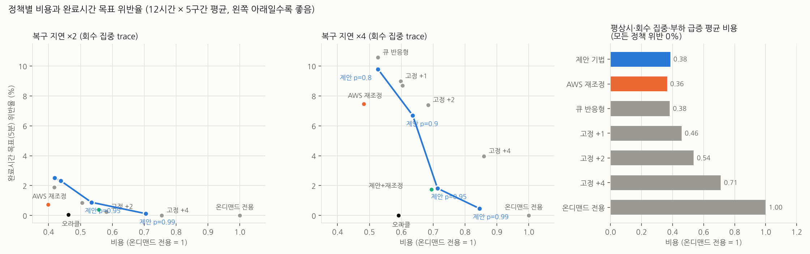
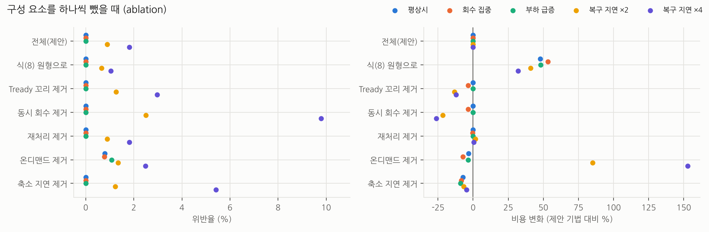
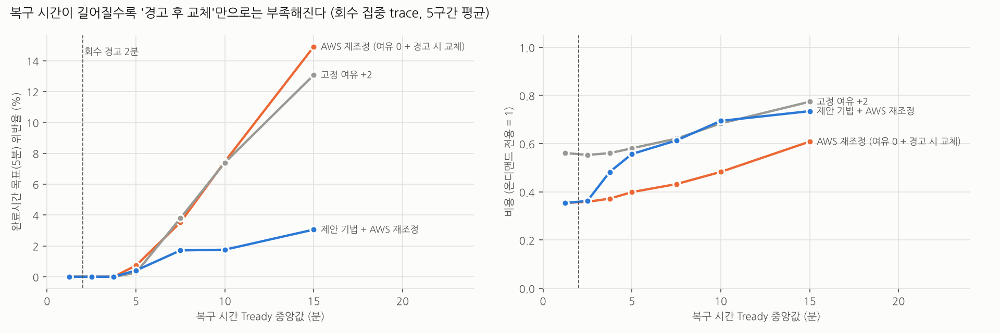

# 2주차: 제어기와 시뮬레이터

작성일: 2026-11-16. 전체 표는 [results-week2-tables.md](results-week2-tables.md), 결정 이유는 [decisions.md](decisions.md),
실패했다가 고친 기록은 [failure-log.md](failure-log.md) 에 있다.

## 한 줄 요약

**복구가 오래 걸리고 회수가 몰릴 때(복구 지연 ×4), 제안 기법은 고정 여유 4대보다 싸면서 위반율이 절반 이하다
(온디맨드 대비 비용 0.71 vs 0.86, 위반율 1.8% vs 4.0%). AWS Capacity Rebalancing 은 가장 싸지만 이 상황에서 위반율이 7.5% 다.
반대로 회수가 드물거나 복구가 빠른 상황에서는 제안 기법이 AWS 기본 기능보다 나은 점이 없다.**

## 무엇을 만들었나

| 위치 | 내용 |
| --- | --- |
| `capacity/estimators.py` | 지수 감쇠 도착률·처리율 (식 3), Tready 분위수 (식 5), 회수 기록의 가중 분위수 f_p (식 6) |
| `capacity/policies.py` | 제안 기법 (식 4~9 + 온디맨드 탐색), 비교 정책 8종, 공통 장치(스팟 부족 시 대체, 축소 지연) |
| `sim/engine.py` | 이산 사건 시뮬레이터. 포아송 도착, 로그정규 처리 시간, trace 기반 회수, 수동 Ack 재처리, Tready 지연, 초 단위 과금 |
| `sim/run_experiments.py` | 실험 7종 970회 (4코어 약 6분) |
| `sim/plots.py` | 표와 그래프 |
| `sim/validate.py` | 실제 시스템과 같은 조건으로 시뮬레이터를 돌려 비교 |
| `tests/test_policies.py` | 중간보고서 표 2(144 → 101 워커시간)를 그대로 재현하는지 포함, 14개 |

`capacity/` 는 시뮬레이터와 3주차 실제 제어기가 **같은 코드**를 쓰도록 분리했다. 시뮬레이션에서 검증한 로직이 그대로 운영에 들어간다.

## 실험 조건

| 항목 | 값 | 근거 |
| --- | --- | --- |
| 작업 도착률 λ | 1.8 건/초 | 중간보고서 예시 |
| 처리율 μ | 0.5 건/초 (작업당 2초), CV 0.57 | 1주차 측정 (`WORK_MICROS_PER_TX=10000`) |
| 완료시간 목표 | 5분 | 10분이면 모든 정책이 위반 0 이라 비교가 안 됨 ([failure-log](failure-log.md) 4번) |
| Tready | 로그정규, 중앙값 150초, q95 ≈ 300초 | 중간보고서 가정. **EC2 측정 후 교체 필요** |
| 회수 | 평상시: AWS CPU 3개 영역 풀 / 회수 집중: AWS 4노드 us-west-2c | 1주차 trace 변환 결과 |
| 평가 구간 | trace 뒤 40% 에서 고른 12시간 × 5구간 | 앞 60% 는 제어기가 과거 기록으로만 본다 (train/test 분리) |
| 가격 | 스팟 $0.037/h, 온디맨드 $0.107/h (c6i.large 서울 가정) | EC2 측정 때 실제 값으로 교체 |
| 제어 주기 Δ, 축소 지연 | 30초, 10분 | 중간보고서 |

시나리오: 평상시, 회수 집중, 부하 급증(1시간 동안 λ × 2), 복구 지연 ×2, ×4 (회수 집중 trace 위에서).

## 결과 1: 비용과 위반율



| 정책 | 평상시 3종 평균 비용 | 복구 지연 ×2 | 복구 지연 ×4 |
| --- | --- | --- | --- |
| 온디맨드 전용 | 1.00 | 0.00% · 1.00 | 0.00% · 1.00 |
| 고정 +2 | 0.54 | 0.25% · 0.58 | 7.39% · 0.68 |
| 고정 +4 | 0.71 | 0.00% · 0.76 | 3.97% · 0.86 |
| 큐 반응형 (여유 0) | 0.38 | 1.89% · 0.42 | 10.58% · 0.53 |
| AWS Capacity Rebalancing | **0.36** | 0.72% · **0.40** | 7.46% · **0.48** |
| **제안 기법 (p = 0.95)** | 0.38 | 0.89% · 0.53 | **1.82%** · 0.71 |
| 제안 기법 (p = 0.99) | 0.58 | 0.12% · 0.70 | 0.47% · 0.84 |
| 제안 + AWS 재조정 | 0.37 | 0.40% · 0.56 | 1.75% · 0.69 |
| 오라클 (미래 회수를 앎) | 0.38 | 0.06% · 0.46 | 0.00% · 0.59 |

비용은 온디맨드 전용을 1 로 둔 값, 칸은 "위반율 · 비용".

읽는 법:
1. **평상시에는 여유 용량이 거의 필요 없다.** 모든 정책이 위반 0 이다. 제안 기법은 이때 여유를 스스로 0 에 가깝게 줄여서
   고정 +2 대비 30% 싸다(0.38 vs 0.54). 중간보고서 예시의 "약 30% 절감"과 같은 크기다.
2. **복구 지연 ×4 에서 차이가 난다.** 고정 여유는 대수를 늘려도 위반율이 잘 안 줄어든다(+4 대도 4.0%). 한 영역에서 함께 회수되면
   여유 스팟도 같이 사라지기 때문이다. 제안 기법은 동시 회수 분위수가 높을 때 일부를 온디맨드로 돌려서 1.8% 로 낮춘다.
3. **AWS 기본 기능과는 장단이 갈린다.** 복구 지연 ×2 에서는 AWS 재조정이 더 싸고 위반율도 낮다(0.40 · 0.72% vs 0.53 · 0.89%).
   회수 경고를 받는 즉시 교체를 시작하는 것이 이 정도 지연에서는 충분하다는 뜻이다.
   복구가 경고 시간(2분)보다 훨씬 길어지면(×4, 평균 약 11분) 경고만으로는 부족하고, 미리 확보한 여유가 필요해진다.
   **둘은 함께 쓸 수 있다.** 제안 + 재조정이 ×2 에서 위반율이 가장 낮은 스팟 정책이다(0.40%).
4. **오라클과의 차이가 남은 개선 여지다.** ×4 에서 오라클은 0.59 비용으로 위반 0 이다. 제안 기법은 시장 trace 의 과거 분포로만
   판단하므로 "이번 위험 구간에 실제로 회수가 오는지"를 모른다. 이 차이를 줄이는 것이 향후 과제다.

구간별로 결과가 크게 흔들린다. 복구 지연 ×4 에서 제안 기법의 구간별 위반율은 1.5, 3.7, 2.0, 1.9, 0.0% 이다.
최종 보고서에는 구간 수를 늘리고 신뢰구간을 함께 적는다.

## 결과 2: 구성 요소별 기여 (ablation)



| 하나씩 뺐을 때 | 복구 지연 ×4 위반율 | 비용 변화 | 해석 |
| --- | --- | --- | --- |
| 전체 | 1.82% | - | |
| 동시 회수 (f_p → 평균 회수율) | 9.79% | −27% | **가장 큰 기여.** 평균 회수율로는 몰려서 회수되는 순간을 못 본다 |
| 축소 지연 | 5.42% | −6% | 줄였다 다시 늘리는 사이가 모두 위험 구간이 된다 |
| Tready 꼬리 (q_p → 평균) | 2.97% | −13% | 복구가 길게 늘어지는 경우를 과소평가 |
| 온디맨드 탐색 (스팟만) | 2.49% | **+152%** | 스팟으로만 버티려면 동시 회수를 감안해 훨씬 많이 띄워야 한다. 평상시에도 스팟 용량이 없는 시간에 위반 0.8% |
| 재처리 (+K) | 1.82% | 0% | **효과 없음.** 작업이 2초라 회수로 돌아오는 K 건이 λ·Trisk 에 비해 무시할 만하다. 작업이 길면 달라질 수 있다 |
| 식 (8) 원형으로 되돌리기 | 1.04% | +31~53% | 원형은 지나치게 보수적이다 ([decisions](decisions.md) D5) |

## 결과 3: 민감도

- **분위수 p**: 0.8 → 0.99 로 올리면 ×4 위반율 9.8% → 0.5%, 비용 0.52 → 0.84. p 하나로 "비용과 위험"을 조절할 수 있다는 것이 운영자에게 주는 손잡이다.
- **완료시간 목표**: 3분으로 줄이면 제안 기법도 회수 집중에서 0.37% 위반이 생긴다. 10분이면 모든 스팟 정책의 ×4 위반율이 1% 아래로 내려온다.
- **회수 경고 시점**: 경고가 2분 전 → 10분 전으로 빨라지면 AWS 재조정의 ×4 위반율이 7.5% → 6.8% 로만 줄어든다.
  경고가 일러도 Tready 가 10분을 넘으면 따라가지 못한다.
- **처리 시간 변동계수 CV**: 0.57 → 2.0 에서도 위반율 변화가 없었다. 식 (7)의 "평균 처리율" 근사는 이 작업 크기에서 문제가 되지 않는다.

## 결과 3-1: 복구 시간에 따른 경계선 (핵심 그래프 후보)



회수 집중 trace 에서 Tready 중앙값을 75초부터 15분까지 바꿨다 (5구간 평균, 비용은 온디맨드 전용 = 1).

| Tready 중앙값 | AWS 재조정 | 고정 +2 | 제안 + AWS 재조정 |
| --- | --- | --- | --- |
| 1.25분 | 0.00% · 0.35 | 0.00% · 0.56 | 0.00% · 0.35 |
| 2.5분 | 0.00% · 0.36 | 0.00% · 0.55 | 0.00% · 0.36 |
| 3.75분 | 0.00% · 0.37 | 0.00% · 0.56 | 0.00% · **0.48** |
| 5분 | 0.72% · 0.40 | 0.25% · 0.58 | 0.40% · 0.56 |
| 7.5분 | 3.52% · 0.43 | 3.79% · 0.62 | **1.70%** · 0.61 |
| 10분 | 7.46% · 0.48 | 7.39% · 0.68 | **1.75%** · 0.69 |
| 15분 | 14.91% · 0.61 | 13.07% · 0.77 | **3.05%** · 0.73 |

- **복구가 4분 이내면 AWS 기본 기능으로 충분하다.** 이 구간에서 제안 기법은 이득 없이 비용만 늘 수 있다(3.75분에서 0.48 vs 0.37). 개선 과제다.
- **복구가 5분을 넘으면 뒤집힌다.** AWS 재조정과 고정 여유의 위반율은 복구 시간에 비례해 커지지만, 제안 기법은 15분에서도 3% 안팎이다.
  고정 여유 +2 와 비용이 같은데 위반율은 1/4 이다.
- 은행 수준 보안 절차(동적 시크릿 발급, 이미지 무결성 확인 등)는 Tready 를 늘린다. EC2 에서 "보안 없음 / 보안 적용" Tready 를 재서
  이 그래프 위에 표시하면, 보안을 강하게 할수록 어느 쪽 영역으로 넘어가는지 보여줄 수 있다.

## 결과 4: 시뮬레이터 검증 (실제 시스템과 비교)

`sim/validate.py`: 실제 시스템(docker compose, 워커 3대, 작업 150건, 작업당 약 2초)을 돌린 뒤, 같은 접수 시각과 실제 처리 시간
분포를 시뮬레이터에 넣어 20회 평균과 비교했다. 회수는 e2e.py 와 같이 N 초마다 워커 하나를 `docker kill`, 3초 + 컨테이너 기동 시간 뒤 복귀.

| 조건 | 지표 | 실제 시스템 | 시뮬레이터 | 오차 |
| --- | --- | --- | --- | --- |
| 회수 없음 | 전체 처리 시간 | 97.6초 | 97.3초 | −0.3% |
| 회수 없음 | 평균 / p95 완료시간 | 49.9 / 92.8초 | 48.2 / 91.1초 | −3.5% / −1.9% |
| 10초마다 회수 | 전체 처리 시간 | 130.2초 | 126.2초 | −3.1% |
| 10초마다 회수 | 평균 / p95 완료시간 | 65.5 / 124.4초 | 62.1 / 119.0초 | −5.1% / −4.4% |
| 5초마다 회수 | 전체 처리 시간 | 170.8초 | 184.2초 | +7.9% |
| 5초마다 회수 | 평균 / p95 완료시간 | 87.1 / 163.0초 | 89.5 / 173.1초 | +2.8% / +6.2% |

세 조건 모두 오차 8% 이내다. 모든 실제 실행에서 대사 결과는 유실·중복·금액 불일치 0 건(PASS)이었다.
회수가 아주 잦으면 시뮬레이터가 조금 비관적이다. 실제 컨테이너는 재시작 직후 바로 큐에 붙는 반면, 시뮬레이터는 "Started" 로그 시간 전체를 기다린다고 두었기 때문으로 보인다.

## 한계 (최종 보고서에 적을 것)

1. Tready 와 가격은 아직 가정값이다. EC2 측정(`tools/measure/ec2_tready.py`) 후 다시 돌려야 한다.
2. trace 는 5분(또는 34초) 간격이다. tick 안의 회수 시각은 균등 분포로 흩뿌렸고, 회수 경고도 tick 시작보다 앞설 수 없다.
3. AWS Capacity Rebalancing 은 "경고 즉시 교체"로 단순화했다. 실제 재조정 권고는 회수보다 훨씬 일찍 오기도 하고 오지 않기도 한다.
   Spot placement score 를 이용한 풀 선택은 단일 풀 실험이라 다루지 않았다(여러 풀은 향후 확장).
4. 회수 경고를 받은 워커가 새 작업을 받지 않게 하는 graceful drain 은 모델링하지 않았다(3주차 구현 대상).
5. 시뮬레이터 검증은 워커 3대, 짧은 실행으로만 했다. 3주차에 제어기를 붙인 뒤 더 긴 실행으로 다시 비교한다.

## 재현

```bash
pip install matplotlib pytest
python3 -m pytest -q tests
python3 -m sim.run_experiments        # data/results/*.csv
python3 -m sim.plots                  # docs/figures/*.png, docs/results-week2-tables.md
```
