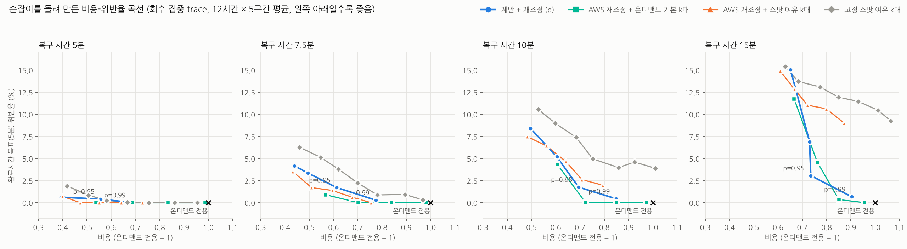
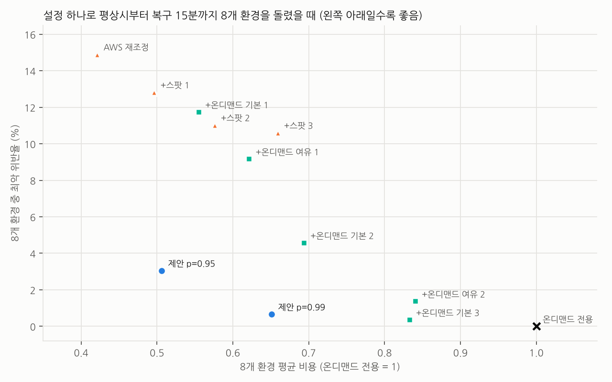

# 4주차 보강: 가장 강한 기준선, 교체 순서, 마감 등급, 중간 저장, 최소 권한과 감사 체인 (2026-11-25)

이 문서는 결론을 바꾼 실험과, 그 과정에서 고친 것을 모았다. 숫자는 모두 `docs/data/` 원자료에서 나온 값이다.

## 1. 교체 순서 버그 (make-before-break)

부팅 10분 실제 시스템 비교(`docs/week4-live-long-boot.md`)에서, 제안 기법은 첫 제어 주기에 "스팟 1 + 온디맨드 3"을 목표로 정하고
준비된 스팟 3대를 **먼저** 내렸다. 온디맨드가 준비되는 10분 동안 일하는 워커가 1대뿐이라 적체가 722건까지 쌓였고, 제어기가 그 적체에
반응해 스팟 4 + 온디맨드 5대까지 늘려 비용도 올랐다.

수정(`controller/fleet.py` `plan_changes`): 준비된 워커는 "준비된 수 − 목표 합계"만큼만 내린다. 부팅 중인 워커는 일을 하지 않으므로 바로 내린다.
못 내린 워커는 다음 주기에 다시 계산한다. 테스트 `tests/test_policies.py::test_fleet_make_before_break_*`.

## 2. 실제 시스템, 부팅 10분, 같은 코드 (원자료 `docs/data/live-long-boot-mbb-2026-11-25.csv`)

설정은 `week4-live-long-boot.md` 와 같다(초당 1.8건, 작업 약 2초, 목표 5분, 워밍업 15분, 회수 기록 실제 속도 재생, 정책당 1회).

| 회수 구간 | 정책 | 마감 초과 | p95 | 비용(45분) | 워밍업 중 최소 준비 대수 · 최대 적체 |
|---|---|---|---|---|---|
| 321.7h (8분에 3대 동시, 13분에 나머지) | 제안 + 재조정, 고치기 전 | 0% | 170초 | $0.436 | 1대 · 722건 |
| | **제안 + 재조정** | **0%** | **71초** | **$0.347** | 4대 · 15건 |
| | 온디맨드 전용 | 0% | 8초 | $0.349 | 4대 · 12건 |
| | 고정 +2 | 40.3% | 485초 | $0.357 | 4대 · 16건 |
| | AWS 재조정 | 48.8% | 568초 | $0.382 | 4대 · 23건 |
| 296.0h (5분에 1대, 10분에 3대, 25분 넘게 스팟 못 만듦) | **제안 + 재조정** | **0%** | **80초** | **$0.342** | 4대 · 15건 |
| | AWS 재조정 + 온디맨드 기본 2대 | 0% | 230초 | $0.352 | 4대 · 16건 |
| | AWS 재조정 | 47.8% | 534초 | $0.361 | 4대 · 21건 |

모든 실행에서 유실 0, 금액 불일치 0.

- 두 위기 구간 모두 제안 기법이 마감 위반 0%이면서 가장 쌌다.
- 위기 구간만 보면 온디맨드 전용·온디맨드 기본 2대와 비용이 거의 같다. 위기에는 온디맨드로 옮겨 가는 것이 정답이고, 제안 기법도 그렇게 했다.
  차이는 평소 비용에서 난다(아래 3).

## 3. 가장 강한 기준선과의 비교 (시뮬레이터, `docs/results-week4-tables.md`)

AWS Auto Scaling 그룹의 혼합 인스턴스 정책(OnDemandBaseCapacity = k: 필요한 대수 중 k 대는 항상 온디맨드)을 기준선에 추가했다.

- **환경 하나에 k 를 맞추면 이 설정이 제안 기법과 같거나 낫다.** 예: 복구 10분에서 온디맨드 기본 2대는 위반 0.00% · 비용 0.72, 제안 p=0.95 는 1.75% · 0.69.
  기존 결론 "복구 7.5분 이상이면 제안 기법이 AWS보다 낫다"는 AWS 기본(재조정만) 기준이었고, 혼합 설정까지 넣으면 성립하지 않는다.

- **설정 하나로 8개 환경(평상시, 부하 급증, 실측 CPU, 회수 집중, 복구 5·7.5·10·15분)을 돌리면 제안 기법이 낫다.**

| 설정 하나로 8개 환경 | 평균 비용 | 최악 위반율 | 평상시 비용 |
|---|---|---|---|
| AWS 재조정 | 0.42 | 14.91% | 0.37 |
| AWS 재조정 + 온디맨드 기본 2대 | 0.69 | 4.57% | 0.68 |
| AWS 재조정 + 온디맨드 기본 3대 | 0.83 | 0.35% | 0.83 |
| 제안 p=0.95 | 0.51 | 3.05% | 0.37 |
| 제안 p=0.99 | 0.65 | 0.67% | 0.53 |

  제안 p=0.99 는 온디맨드 기본 2대보다 평균 비용과 최악 위반율이 모두 낮고, 온디맨드 기본 3대와 거의 같은 안전을 약 22% 싸게 얻는다.

**고친 결론:** 복구 시간과 회수 패턴을 미리 알 수 없을 때, 회수 위험(복구 시간 꼬리, 동시 회수 비율)을 직접 재서 반영하면 같은 안전을 더 싸게 얻는다.
환경이 일정하고 잘 알려져 있으면 AWS 혼합 설정으로 충분하다. 복구가 4분 이하면 AWS 기본(재조정)으로 충분하다.

## 4. 마감 등급 우선순위 (`scripts/priority_drill.py`, 원자료 `docs/data/priority-drill-2026-11-25.csv`)

접수 때 `priority`(URGENT 마감 2분 / NORMAL 5분)와 `deadline_at` 을 저장하고, 우선순위 큐(`x-max-priority`)로 급한 작업을 먼저 꺼낸다.
`QUEUE_MAX_PRIORITY=0` 이면 예전처럼 접수 순서. 대사(`/reconciliation`)에 등급별 마감 초과(`deadlineByPriority`)를 추가했다.

실험: 워커 4대, 초당 1.5건(20% 급한 작업), 작업 약 2초. 120초에 워커 3대를 경고 없이 종료, 교체 워커는 5분 뒤 준비. 작업 923건(급한 작업 184건).

| 방식 | 급한 작업 마감 초과 | 급한 p95 | 보통 작업 마감 초과 | 보통 p95 | 정합성 |
|---|---|---|---|---|---|
| 접수 순서 | 68.5% | 217초 | 0% | 215초 | OK |
| 우선순위 큐 | **0%** | **6.5초** | 0% | 261초 | OK |

서버 대수(인프라)로 막지 못하는 복구 몇 분을 처리 순서(백엔드)로 메운다. 대가로 보통 작업 p95 가 46초 늘었지만 마감 안이다.
보통 작업이 계속 밀리는 기아(starvation)는 적체가 영구적이면 생길 수 있다. 이 실험은 적체가 일시적인 경우다.

## 5. 긴 작업 중간 저장 (`notice_drill.py --modes none checkpoint`, 원자료 `docs/data/checkpoint-drill-2026-11-25.csv`)

워커가 거래 N 건마다 (마지막 tx_id, 건수, 합계)를 `job_checkpoints` 에 저장하고, 다시 받은 작업은 저장 지점 다음 거래부터 계산한다.
- 입력 거래는 바뀌지 않고 tx_id 순서로 더하므로, 같은 지점이면 누가 저장해도 같은 값이다. 저장은 앞으로만 간다(건수가 늘 때만 덮어씀).
- 결과 확정은 여전히 결과 PK 한 번이라 정합성 조건은 바뀌지 않는다. 저장은 속도를 위한 장치다.
- 어디서 끊어 이어도 합계가 같은지 300개 지점에서 확인(`SettlementAccumulatorTest`).

실험: 60초 작업 24건, 워커 4대, 45초마다 1대를 경고 없이 종료(6회), 교체 15초. 거래 10건(6초)마다 저장.

| 방식 | 이어 계산 | 아낀 계산 | p95 | 전체 처리 시간 | 정합성 |
|---|---|---|---|---|---|
| 저장 안 함 | 0 | 0초 | 461초 | 503초 | OK |
| 10건마다 저장 | 6 | **240초** | **380초** | **423초 (−16%)** | OK |

회수 경고(drain)는 경고가 와야 쓸 수 있지만, 중간 저장은 경고 없이 죽어도 손실을 줄인다.

## 6. 믿을 수 없는 서버에 무엇을 맡기나: 워커 최소 권한과 결과 감사 체인 (`scripts/security_drill.py`, 원자료 `docs/data/security-drill-2026-11-25.csv`)

GameDay 1회차(`docs/gameday/report-1.md`)에서 확정된 결과 1건을 DB 에서 직접 1원 바꿨을 때, 대사가 10초 만에 잡았지만 두 가지가 비어 있었다.
결과 테이블에 UPDATE 가 그냥 됐고, 누가 바꿨는지 알 수 없었다. 스팟은 믿을 수 없는 서버라는 전제에서 이 둘을 고쳤다(`V3__worker_least_privilege_and_result_audit.sql`).

- **워커 전용 계정** `swallow_worker_app`: 결과·이력은 추가(INSERT)만 된다. 바꾸거나 지울 수 없고, 입력 거래는 읽기만, 작업은 완료 표시 두 칸만 바꿀 수 있다.
- **결과 감사 체인** `result_audit`: 결과가 추가·변경·삭제될 때마다 DB 트리거가 (DB 계정, 접속 주소, 시각, 값)을 앞 줄 해시와 묶어 SHA-256 체인에 남긴다.
  워커는 이 표를 읽지도 못하고, 기록 함수를 직접 부를 수도 없다. 소유자도 UPDATE·DELETE·TRUNCATE 가 막힌다.
- **대사에 체인 검사 추가** (`/reconciliation` 의 `auditChain`, 지표 `swallow_recon_audit_violations`, 기존 "대사 불일치" 알림에 포함):
  해시를 다시 계산해 끊긴 줄(`brokenLinks`), 지금 결과가 마지막 감사 기록과 다른 작업(`untracked`), DB 밖에 남긴 끝 해시와 달라진 줄(`anchorMismatch`)을 센다.

시험: 작업 40건을 3초마다 워커를 죽이며 처리(e2e PASS, 감사 기록 40줄 = 결과 40건, 체인 정상)하고 체인 끝 해시를 DB 밖에 남긴 뒤 아래를 시도했다. **23개 중 23개 통과.**

| 시도 | 결과 |
|---|---|
| A. 워커 계정으로 결과·이력 UPDATE/DELETE, 입력 거래 UPDATE, 작업 내용 변경 | 모두 permission denied |
| A. 워커 계정으로 감사 기록 읽기·추가, 기록 함수 직접 호출, 트리거 끄기, 스스로 권한 주기 | 모두 거부 (GRANT 는 경고만 내고 권한은 생기지 않음) |
| B. 관리자 계정으로 금액 1원 변경 (GameDay 와 같은 변조) | 감사 체인에 `swallow UPDATE` 로 남고, 대사 금액 불일치 1 |
| C. 관리자가 감사 트리거를 끄고 금액이 아닌 값(worker_id)을 변경 | 금액 대사로는 안 보이지만(불일치 0), 체인 검사가 `untracked=1` 로 잡음 |
| D. 감사 기록 DELETE·TRUNCATE | 소유자도 거부 |
| D. 감사 트리거까지 끄고 흔적을 지우려 감사 기록을 고침 | 해시 체인이 끊겨 `brokenLinks=1` |
| E. 흔적을 완전히 지우려 감사 기록을 고치고 체인 전체를 다시 계산 | DB 안의 검사(끊긴 줄·체인 밖 변경·금액)는 모두 0 으로 속지만, DB 밖에 남긴 끝 해시와 달라 `anchorMismatch=1` |

발견: 처음에는 워커에게 결과 INSERT 만 줬더니 작업 40건이 **전부 DLQ** 로 갔다. `INSERT ... ON CONFLICT (job_id)` 가 충돌 검사로 결과 PK 칸을 읽어야 해서다.
권한 오류는 다시 해도 실패하므로 독성 메시지로 분류된 것은 맞는 동작이다. 결과 표 전체가 아니라 `job_id` 한 칸 읽기만 더해 고쳤다.
권한을 줄이는 변경은 문법 검사가 아니라 실제 처리 경로로 돌려 봐야 한다. 시험은 CI 의 e2e 뒤에 붙였다.

한계:
- DB 최고 관리자가 체인 전체를 다시 계산해 덮는 경우는 체인 끝 해시를 DB 밖에 남겨(`AuditAnchor`, 기본 1분마다) 잡는다(시험 E). 단, 로컬에서는 DB 와 다른 Docker 볼륨의 파일일 뿐이다. 운영에서는 DB 관리자가 손댈 수 없는 저장소(한 번 쓰면 지울 수 없는 객체 저장소 등)에 두어야 하고, 마지막 앵커 이후(최대 1분)의 변조는 다음 앵커가 그대로 적으므로 잡지 못한다.
- 체인 기록은 한 번에 하나씩(advisory lock) 한다. 확정 트랜잭션이 짧아 위 실험에서 문제는 없었지만, 처리량에 주는 영향은 따로 재지 않았다.
- 로컬 환경의 비밀번호는 고정 기본값이고, 관리·DLQ API 에는 인증이 없다. EC2 측정에서는 Vault 동적 시크릿과 포트 닫기를 썼다(`docs/tready-ec2.md`).

## 7. 이론(시뮬레이터)과 실제의 차이

| 이론에서는 | 실제로 돌려 보니 | 다음 설계에서 고려할 점 |
|---|---|---|
| 목표 대수를 정하면 바로 바뀐다 | 전환할 때 기존 서버를 먼저 내려 일하는 서버가 1대까지 떨어졌다 | 새 서버가 준비된 뒤에 기존 서버를 내린다 |
| 제어기 스스로 만든 적체는 없다 | 그 적체에 반응해 서버를 과하게 늘려 비용이 올랐다 | 제어기의 행동이 다음 판단을 흔들지 않게 한다 |
| 경고를 받고 마무리하면 빨라진다 | 마무리만 하면 일하는 서버가 일찍 빠져 더 느렸다 | 경고를 받으면 교체부터 요청한다 |
| DB 오류는 일시/영구로 깔끔히 나뉜다 | DB 재시작 중 오류가 다른 예외로 감싸져 정상 작업이 DLQ 로 갔다 | 원인 사슬 끝까지 보고 분류한다 |
| 부팅 중인 서버도 경고를 받는다 | 시작할 때 지난 경고 파일을 지워 부팅 중 경고를 놓쳤다 | 프로세스가 뜨기 전에 온 신호도 남긴다 |
| 복구에 2.5분쯤 걸린다 | 서울 CPU 실측 15초라 제안 기법이 필요 없었다 | 전략을 고르기 전에 복구 시간부터 잰다 |
| 회수 위험을 반영하면 AWS보다 낫다 | 환경을 알고 온디맨드 k 대를 맞추면 그쪽이 같거나 나았다 | 환경이 일정하면 고정 설정, 바뀌면 적응형 |
| 권한은 빼기만 하면 된다 | 결과 INSERT 만 줬더니 충돌 검사에 PK 읽기가 필요해 작업 40건이 전부 DLQ 로 갔다 | 권한을 줄인 뒤 실제 처리 경로로 돌려 본다 |

## 한계

- 실제 시스템 비교는 구간·정책마다 1회다. 회수 기록은 GPU 4대 클러스터 하나와 CPU 풀 하나뿐이다.
- 실제 GPU 와 실제 EC2 가 아니다. 부팅 지연은 흉내 낸 값이다.
- 22% 비교(설정 하나로 8개 환경)는 시뮬레이션 결과다. 실제 시스템에서는 위기 구간 두 곳만 확인했다.
- 기존 논문 방식(평균 회수율 기반, Snape 계열)은 단순화한 재구현이다.
